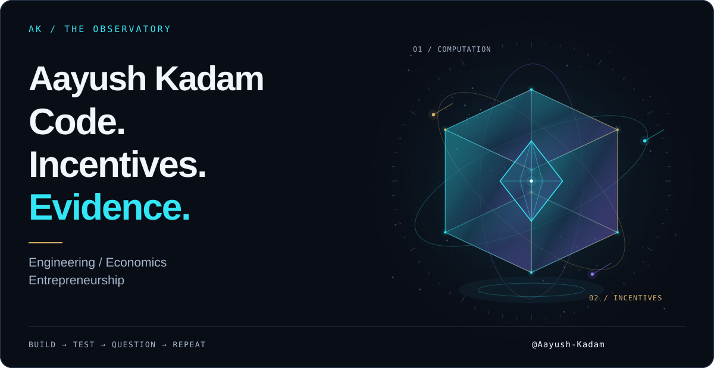
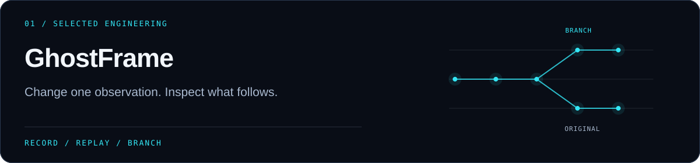
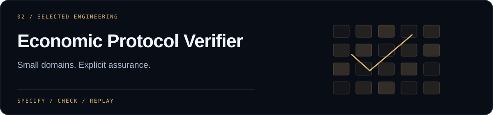
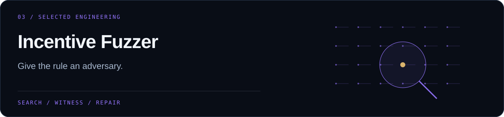
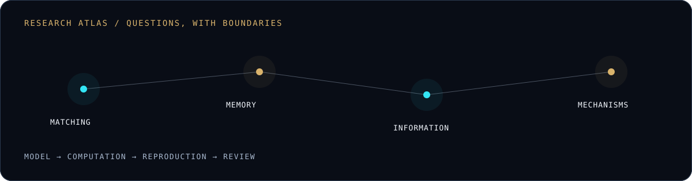

<picture>
  <source media="(max-width: 600px)" srcset="assets/hero/observatory-mobile.svg">
  
</picture>

# Aayush Kadam

**I build tools that make difficult claims easier to interrogate.**

Computer Science sophomore at **MIT ADT University, Pune**. Founder building developer tools and experimental software, with a research interest in incentives, AI systems, and how decisions survive contact with evidence. Long term, I'm interested in the meeting point of entrepreneurship and finance.

[Explore the engineering ↓](#selected-engineering) · [Enter the research atlas ↓](#research-atlas) · [Talk shop ↗](#connect)

## On the workbench

**Agent infrastructure** — recording what happened, reproducing supported executions, and making a changed observation inspectable. 
**Computational economics** — strategic delay, algorithmic bidders, and incentives created by persistent records. 
**Experimental products** — developer tools and research interfaces with visible assumptions and reproducible examples.

## Selected engineering

A local-first recorder and counterfactual debugger for **supported deterministic AI-agent workflows**. Python captures execution into SQLite; a React/TypeScript interface makes the evidence explorable.

**The interesting part:** replay a supported policy, replace one observation, and compare the new continuation with the preserved original.

`Python` `SQLite` `FastAPI` `React / TypeScript` 
**Pre-release.** Arbitrary SDK functions support playback only; general agent resumption and live-model replay are not implemented.

[Inspect the source ↗](https://github.com/Aayush-Kadam/ghostframe) · [Architecture](https://github.com/Aayush-Kadam/ghostframe/blob/main/docs/architecture.md) · [Synthetic demo](https://github.com/Aayush-Kadam/ghostframe#start-the-synthetic-demonstration)

Bounded verification for selected economic protocols: finite semantics, exhaustive and SMT checks, replayable counterexamples, and checked proof certificates for specific compiled obligations.

**The interesting part:** assurance levels distinguish enumeration, solver results, and independent certificate checking instead of calling all three “proof.”

`Python` `Z3 / cvc5` `Alethe / Carcara` 
**Research preview.** Finite declared domains; economic-to-logic translation remains trusted. V3 requires the pinned external checker. Restrictive reuse terms apply.

[Inspect the source ↗](https://github.com/Aayush-Kadam/economic-protocol-verifier) · [Reviewer walkthrough](https://github.com/Aayush-Kadam/economic-protocol-verifier/blob/main/docs/REVIEWER_WALKTHROUGH.md) · [Trust boundaries](https://github.com/Aayush-Kadam/economic-protocol-verifier/blob/main/TRUST_AND_ASSURANCE.md)

Adversarial testing for bounded economic rules. Specify the rule, search feasible behavior, replay a witness exactly, and regression-test a proposed repair.

**The interesting part:** counterexamples and benchmark misses remain inspectable alongside successful checks.

`Python` `Exact evaluation` `Z3` 
**Research preview.** Component benchmarks are not real-world audit accuracy or behavioral forecasts. No software license has been selected; check reuse terms.

[Inspect the source ↗](https://github.com/Aayush-Kadam/incentive-fuzzer) · [Reviewer walkthrough](https://github.com/Aayush-Kadam/incentive-fuzzer/blob/master/docs/REVIEWER_WALKTHROUGH.md) · [Reuse terms](https://github.com/Aayush-Kadam/incentive-fuzzer/blob/master/LICENSE_DECISION.md)

## Research atlas

**01 / Matching — [WAITLAB](https://github.com/Aayush-Kadam/WaitLab)** 
When does waiting change the pool worth waiting for? Strategic delay, dynamic matching, and synthetic response recovery. [Paper-to-code map](https://github.com/Aayush-Kadam/WaitLab/blob/main/docs/PAPER_TO_CODE.md). **Released computational research software; synthetic evidence.**

**02 / Memory — [The Economics of Forgetting](https://github.com/Aayush-Kadam/economics-of-forgetting)** 
How do persistent records change the return to rehabilitation? A finite-horizon model with regional results. **Working paper; not peer reviewed.**

**03 / Information — [VERITAS](https://github.com/Aayush-Kadam/veritas-computational-lab)** 
What happens when persuasive evidence is cheap and verification is scarce? A computational lab for deception, congestion, and Bayesian demand. **Model-generated evidence; mixed recovery results.**

**04 / Mechanisms — [Delegation-Proof Market Design](https://github.com/Aayush-Kadam/delegation-proof-market-design)** 
How do auction rankings change when algorithms bid? Finite-horizon revenue–allocation tradeoffs, scoped certificates, and failed repairs. **Research artifacts; no successful delegation-proof mechanism claimed.**

These are computational studies and working materials. A public repository or archive DOI does not establish peer review or external replication. [More experiments ↗](https://github.com/Aayush-Kadam?tab=repositories)

## Tools behind the work

| Practice | Tools I use |
| :--- | :--- |
| Languages & interfaces | Python · TypeScript · JavaScript · React |
| Systems | FastAPI · SQLite · Git |
| Verification & reliability | Z3 · cvc5 · Pytest · Hypothesis · Ruff · mypy · GitHub Actions |
| Computational research | NumPy · Pandas · finite models · seeded simulation |

## Live signals

The view counter records provider-served image requests, including previews and repeat loads. GitHub caching affects updates; this is **not unique visitors or lifetime profile traffic**. Stars and CI are cached live service images. If a badge is unavailable, its source link remains usable. [How these signals work](docs/MAINTENANCE.md#live-signals).

## A working principle

I'd rather find the counterexample myself.

The fun starts when a clean idea meets a stubborn result: an agent that cannot replay, an auction rule that invites a better strategy, or a model that loses to its baseline. I want the failure small enough to reproduce, and the next version better for having found it.

## Connect

Building agent infrastructure, checking a mechanism, or arguing with a model? Let's compare notes.

**[GitHub ↗](https://github.com/Aayush-Kadam) · [LinkedIn ↗](https://www.linkedin.com/in/aayush-kadam-18545a217)**

Original Observatory artwork · [Sources & maintenance](docs/MAINTENANCE.md) · Built to be inspected.
