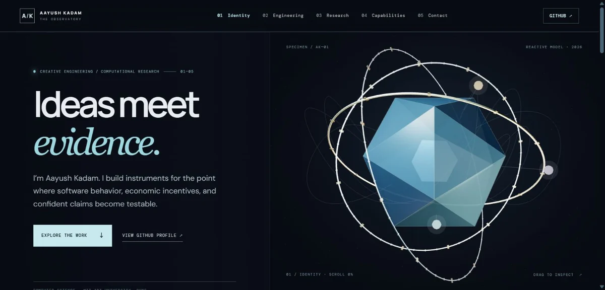

<picture>
  <source media="(max-width: 600px)" srcset="assets/hero/observatory-v2-mobile.webp">
  
</picture>

# Aayush Kadam

### Ideas meet evidence.

I build instruments for the point where **software behavior, economic incentives, and confident claims become testable**. I'm a Computer Science sophomore at MIT ADT University, Pune, working across developer tools and computational research.

<table>
<tr><td><strong>LIVE PROFILE IMAGE REQUESTS</strong>  Hits.sh counts requests for this badge, including repeat loads and previews. GitHub's image cache may delay updates. This is not a unique-visitor or lifetime-profile-view count.</td></tr>
</table>

> **The 3D experience is built and under review.** GitHub README pages cannot run WebGL or react to a cursor. The image above is a real screenshot of the separate interactive site. Public access awaits owner-approved GitHub Pages deployment.

### [EXPLORE THE INTERACTIVE BUILD AND LOCAL PREVIEW ↗](site/README.md)

Once deployment is approved and verified, this gateway will link directly to the live site. The current link opens the build and review instructions; it does not imply the site is public.

---

## Selected instruments

**[GhostFrame ↗](https://github.com/Aayush-Kadam/ghostframe)** — Record supported deterministic AI-agent executions, change one observation, and inspect the resulting continuation against the preserved original. **Pre-release:** arbitrary SDK functions support playback only; general agent resumption and live-model replay are not implemented.

**[Economic Protocol Verifier ↗](https://github.com/Aayush-Kadam/economic-protocol-verifier)** — Bounded verification for selected economic protocols with finite semantics, replayable counterexamples, and scoped certificate checks. **Research preview:** the economic-to-logic translation remains trusted; the external checker is required for the strongest assurance level.

**[Incentive Fuzzer ↗](https://github.com/Aayush-Kadam/incentive-fuzzer)** — Search feasible behavior for a counterexample, replay the witness exactly, and regression-test a proposed repair. **Research preview:** bounded component tests are not forecasts or real-world audit accuracy; no software license has been selected.

## Computational research

| Question | Public work | Scope |
| :-- | :-- | :-- |
| When does waiting change the pool worth waiting for? | [WAITLAB ↗](https://github.com/Aayush-Kadam/WaitLab) | Strategic delay and synthetic response recovery; research software |
| How do persistent records change incentives to rehabilitate? | [The Economics of Forgetting ↗](https://github.com/Aayush-Kadam/economics-of-forgetting) | Finite-horizon model; working paper, not peer reviewed |
| What happens when persuasive evidence is cheap? | [VERITAS ↗](https://github.com/Aayush-Kadam/veritas-computational-lab) | Computational lab; model-generated evidence with mixed recovery results |
| How do auction rankings change when algorithms bid? | [Delegation-Proof Market Design ↗](https://github.com/Aayush-Kadam/delegation-proof-market-design) | Finite-horizon artifacts; no successful general mechanism claimed |

Public repositories and archive records do not establish peer review or independent replication.

## The working method

**Preserve the source. Expose the assumption. Reproduce the result.** Python and TypeScript for instruments; SQLite and React for inspectable interfaces; Z3/cvc5, finite models, Pytest, and Hypothesis for bounded claims.

## Connect

Building agent infrastructure, checking a mechanism, or arguing with a model? [Connect on LinkedIn ↗](https://www.linkedin.com/in/aayush-kadam-18545a217).

[Source and claim ledger](docs/SOURCES.md) · [Counter and artwork notes](docs/MAINTENANCE.md) · [Interactive build](site/README.md)
